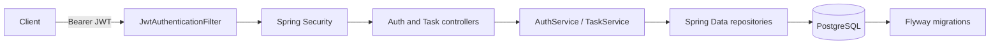

# Task Manager API

[](https://github.com/Asyl-k/task-manager-api/actions/workflows/ci.yml)

A secure task management REST API built with Java 21 and Spring Boot. It demonstrates JWT authentication, per-user ownership, optimistic locking, PostgreSQL migrations, validation, pagination and a consistent RFC 9457 error contract.

## Stack

Java 21 · Spring Boot 3.5 · Spring Security · Spring Data JPA · PostgreSQL · Flyway · JWT (JJWT) · Bean Validation · springdoc-openapi · JUnit 5 · Mockito · Testcontainers · Maven · Docker · GitHub Actions

## Architecture



The HTTP layer contains no persistence logic. Services own transactions and business rules, repositories own queries, and entities never leave the application boundary.

## Quick start with Docker

Requirements: Docker Desktop or Docker Engine with Compose v2.

```bash
cp .env.example .env
docker compose up --build
```

The API starts on `http://localhost:8080`. Swagger UI is available at `http://localhost:8080/swagger-ui.html`.

The local profile creates two demo accounts on first start:

| Username | Password | Role |
|---|---|---|
| `admin` | `admin12345` | `ADMIN` |
| `demo` | `demo12345` | `USER` |

These credentials exist for local demonstration only. Override them with `DEMO_ADMIN_PASSWORD` and `DEMO_USER_PASSWORD`, or disable seeding with `DEMO_DATA_ENABLED=false`.

## Run locally without Docker

Requirements: JDK 21, PostgreSQL 17 and Maven (or the included wrapper).

```bash
createdb tasks
export SPRING_DATASOURCE_URL=jdbc:postgresql://localhost:5432/tasks
export SPRING_DATASOURCE_USERNAME=your_user
export SPRING_DATASOURCE_PASSWORD=your_password
./mvnw spring-boot:run -Dspring-boot.run.profiles=local
```

Flyway applies the schema automatically. The application fails fast if `app.jwt.secret` is empty in a non-local profile.

## Authentication

```bash
curl -s -X POST http://localhost:8080/api/auth/register \
  -H 'Content-Type: application/json' \
  -d '{"username":"alice","password":"password123"}'
```

The response contains a short-lived bearer token:

```json
{
  "accessToken": "eyJhbGciOiJIUzI1NiJ9...",
  "tokenType": "Bearer",
  "expiresIn": 900
}
```

Use it for protected endpoints:

```bash
export TOKEN="<accessToken>"
curl -s http://localhost:8080/api/me -H "Authorization: Bearer $TOKEN"
```

## API

| Method | Path | Description |
|---|---|---|
| `POST` | `/api/auth/register` | Register a user and receive a token |
| `POST` | `/api/auth/login` | Authenticate and receive a token |
| `GET` | `/api/me` | Current user profile |
| `GET` | `/api/tasks` | Current user's tasks; `status`, `page`, `size`, `sort` |
| `GET` | `/api/tasks/{id}` | One task, if owned by the caller (admins may read any) |
| `POST` | `/api/tasks` | Create a task owned by the caller |
| `PUT` | `/api/tasks/{id}` | Replace title and description |
| `PATCH` | `/api/tasks/{id}/status` | Change status; body `{"status":"IN_PROGRESS"}` |
| `DELETE` | `/api/tasks/{id}` | Delete a task |
| `GET` | `/api/admin/tasks` | All tasks; requires `ADMIN` |

Task status transitions are explicit:

```text
TODO -> IN_PROGRESS -> DONE
         ^              |
         +--------------+
```

Skipping `IN_PROGRESS` or changing a task to the same status returns `409 Conflict`. A completed task can be reopened.

Create and list tasks:

```bash
curl -s -X POST http://localhost:8080/api/tasks \
  -H "Authorization: Bearer $TOKEN" \
  -H 'Content-Type: application/json' \
  -d '{"title":"Prepare portfolio","description":"Rewrite the README"}'

curl -s "http://localhost:8080/api/tasks?status=TODO&page=0&size=20" \
  -H "Authorization: Bearer $TOKEN"
```

## Error format

All errors use `application/problem+json` and a stable `code` field:

```json
{
  "title": "Validation failed",
  "status": 400,
  "detail": "One or more request fields are invalid",
  "code": "validation_failed",
  "errors": {
    "title": "must not be blank"
  },
  "timestamp": "2026-11-19T00:00:00Z"
}
```

| Status | When |
|---|---|
| `400` | Validation, malformed JSON, invalid query parameter or sort field |
| `401` | Missing, invalid or expired token; bad credentials |
| `403` | Another user's task or an admin-only endpoint |
| `404` | Unknown task or resource |
| `409` | Duplicate username, invalid status transition, optimistic lock conflict or data conflict |

## Tests

```bash
./mvnw test      # unit tests, no Docker required
./mvnw verify    # unit + PostgreSQL integration tests via Testcontainers
```

Integration tests are tagged with `@Testcontainers(disabledWithoutDocker = true)`: without Docker they are skipped locally, and GitHub Actions runs them against `postgres:17-alpine`. The CI pipeline also builds the Docker image, starts the Compose stack, waits for `/actuator/health` and exercises registration and task creation.

## Design decisions

- **Stateless JWT authentication** with BCrypt cost 12 and a 15-minute access token.
- **Ownership in the service layer**: a user can only read or mutate their own tasks; `ADMIN` can access everything.
- **Optimistic locking** with `@Version`; concurrent updates return `409` instead of silently overwriting.
- **Flyway migrations** with Hibernate `ddl-auto: validate`, so the schema is reproducible and checked at startup.
- **Response DTOs** keep JPA entities out of the HTTP contract.
- **Pagination and filtering** prevent unbounded list responses.
- **Problem Details** give clients a machine-readable error contract.

## Scope and limitations

This is a focused portfolio project, not a production identity provider. It intentionally does not include refresh tokens, email verification, password reset, rate limiting or multi-tenancy. The demo credentials are local-only and must never be used in a deployed environment.

## License

MIT
